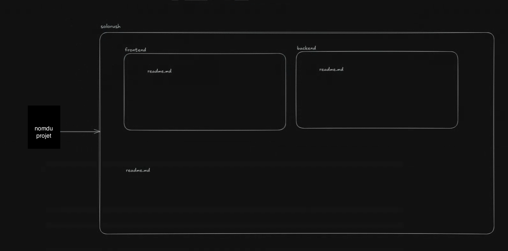

# Projet_FullStack

# Comment initialiser un projet fullstack... :

1. Créer un dossier nomduprojet (i.e. racine du projet) avec `mkdir nomduprojet` et créer un repo sur Github avec le nomduprojet
2. Créer un projet React avec Vite et le nommer frontend
3. git clone le repo du backend du formateur et le renommer backend avec `mv` tel que : `mv anciennomdurepo backend`
4. Supprimer le .git du dossier backend/, synchroniser avec le repo nomduprojet Github
5. Nettoyer les dossiers frontend/ et backend/ puis retourner sur le terminal racine du projet et `git add .`, `git commit -m "Initialization of the project"`et `git push` ou `git push --set-upstream origin nomdelabranche`
6. Créer une branche `dev`avec la commande : `git checkout -b dev` depuis la racine

# ... À faire le lien entre database, backend et frontend... :

7. Créer une database avec l'aide de SQLectron et lié + l'afficher dans le backend/ (Penser à dans le backend/ : (a) installer les packages `pg` et `@types/pg` tels que : `npm i pg` et `npm i -dev @types/pg`, et (b) créer un fichier .env)
8. Lier la database du backend/ en la lisant comme étant une API dans le frontend/ (le lien pour l'API == lien du backend/ dans le navigateur) + extraire les données et les exploiter

# ... À cibler une donnée spécifique... :

9. Définir un nouveau chemin avec `/:id` dans le backend/ avec app.get(){} et utiliser impérativement id=$1 lors dans la requête pour raison de sécurité
10. Définir des `Routes/Route/BrowserRouter/Link` du package "react-router" pour le nouveau chemin (et les autres nécessaires au projet)

# ... Et la supprimer !

11. Définir un nouveau chemin avec le même `/:id` dans le backend/ avec app.get(){} et une requête avec `DELETE`

# Détails :

- créer un fichier `readme.md`
- initialiser un frontend/
  - `npm create vite@latest frontend`
    - React
    - TS
    - ESLint
    - y
  - nettoyer le sous-dossier créé
    - supprimer frontend/src/\*.css
    - supprimer les appels au css dans frontend/src/\*.tsx
    - vider le fichier frontend/src/App.tsx
    - supprimer frontend/public/icons.svg

  - npm i

- initialiser un backend/
  - `git clone git@github.com:LoicBrassart/dwwm-ts-backend-express-template.git`
    - supprimer .git
  - créer le .env
  - nettoyer le sous-dossier
  - retirer la route GET/pokemon
  - créer une route GET/ simple

  - npm i

- utiliser le git workflow (main < dev < features)

- initialiser une bdd :
  - créer des users (optionnel):
    - superuser (tous les droits) : `CREATE ROLE thisIsMe WITH LOGIN SUPERUSER PASSWORD 'myP@ssw0rd'`;
    - user classique : `CREATE ROLE thisIsMe WITH LOGIN PASSWORD 'myP@ssw0rd'`

  - créer des databases (projets) : `CREATE DATABASE project_name;` ou `CREATE DATABASE project_name OWNER thisIsMe;`
  - créer des tables (entités) : `CREATE TABLE article(id integer not null generated always as identity primary key, title text not null unique);`

- lier le backend à la bdd
  - packages `pg` (dependency) & `@types/pg` (devDependency)
  - environnement (`dotenv`)
    - créer un .env qui contient toutes les infos sensibles (postgres: host, port, user, password, db ; api: port)
    - ajouter le .env au .gitignore !
  - créer la connexion
    - créer un `Pool` de connexions à PGSQL (import depuis `pg`)
    - appeler les variables d'environnement via `process.env.xxxx`
  - créer une première requête
    - créer une route dédiée (ex: GET /logs)
    - demander au serveur SQL d'exécuter une requête (`db.query`)

- lier le frontend au backend
  - mon composant a besoin de faire qqc "au lancement" (effect). Il doit:
    - appeler une API (`fetch`)
    - nettoyer le resultat (`.json()`)
    - stocker le resultat et redeclencher un affichage (state)
  - a l'affichage, pour chaque donnée en state j'affiche un fragment de TSX (`.map()`)
  - [Bonus] créer un type TS custom pour avoir l'autocomplétion sur les sous-propriétés de mon state

- afficher un seul tuple de ma base
  - [bdd] une requete SQL
  - [backend] une nouvelle route GET/logs/:id
  - [frontend]
    - react-router
      - main.tsx: BrowserRouter
      - App.tsx: Routes
    - une nouvelle page
    - lien dynamique Home -> Log
    - Header omnipresent avec lien -> Home

- supprimer un article
  - [bdd] une requete SQL
  - [backend] une nouvelle route DELETE/logs/:id
  - [frontend]
    - un bouton "supprimer"

# Piste possible de projet :

Séismes, créer une page permettant de localiser des séismes sur une carte et de faire des projections 2D, chaque séisme a une fiche de présentation contenant les infos suivants : date, localisation 3D, magnitude, photos du lieu ou des dégâts + 1 zone permettant de donner son ressenti si la personne a été présente

# Note :

Possibilité de créer le repo de deux manières :

- Option 1 : Le monorepo, 1 repo = le projet
  

- Option 2 : Le deux repo dans le projet
  

  Ici, l'option 1 a été choisie et les readme des dossiers frontend/ et backend/ ont été supprimés
