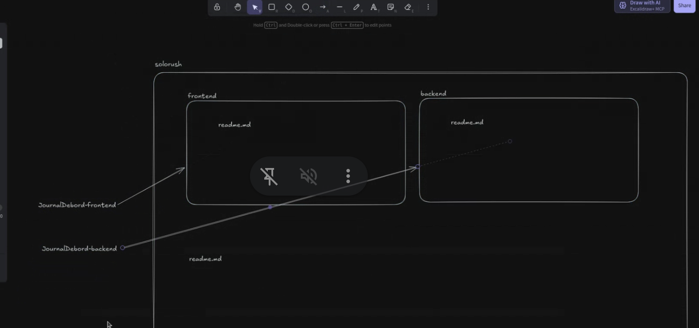

# Projet_FullStack

# Comment initialiser un projet fullstack :

1. Créer un dossier nomduprojet avec `mkdir nomduprojet` et créer un repo sur Github avec le nomduprojet
2. Créer un projet React avec Vite et le nommer frontend
3. git clone le repo du backend du formateur et le renommer backend avec `mv` tel que : `mv anciennomdurepo backend`
4. Supprimer le .git du dossier backend/, synchroniser avec le repo nomduprojet Github
5. Nettoyer les dossiers frontend/ et backend/ puis retourner sur le terminal racine du projet et `git add .`, `git commit -m "Initialization of the project"`et `git push` ou `git push --set-upstream origin nomdelabranche`

# Détails :

- créer un readme
- initialiser un frontend
  - `npm create vite@latest frontend`
    - React
    - TS
    - ESLint
    - y
  - nettoyer le sous-dossier créé
    - supprimer frontend/src/\*.css
    - supprimer les appels au css dans frontend/src/\*.tsx
    - vider le fichier frontend/src/App.tsx
    - supprimer frontend/public/icons.svg

- initialiser un backend
  - `git clone git@github.com:LoicBrassart/dwwm-ts-backend-express-template.git`
    - supprimer .git
  - créer le .env
  - nettoyer le sous-dossier
  - retirer la route GET/pokemon
  - créer une route GET/ simple

# Piste possible de projet :

Séismes, créer une page permettant de localiser des séismes sur une carte et de faire des projections 2D, chaque séisme a une fiche de présentation contenant les infos suivants : date, localisation 3D, magnitude, photos (?)

# Note :

Possibilité de créer le repo de 2 manières :

